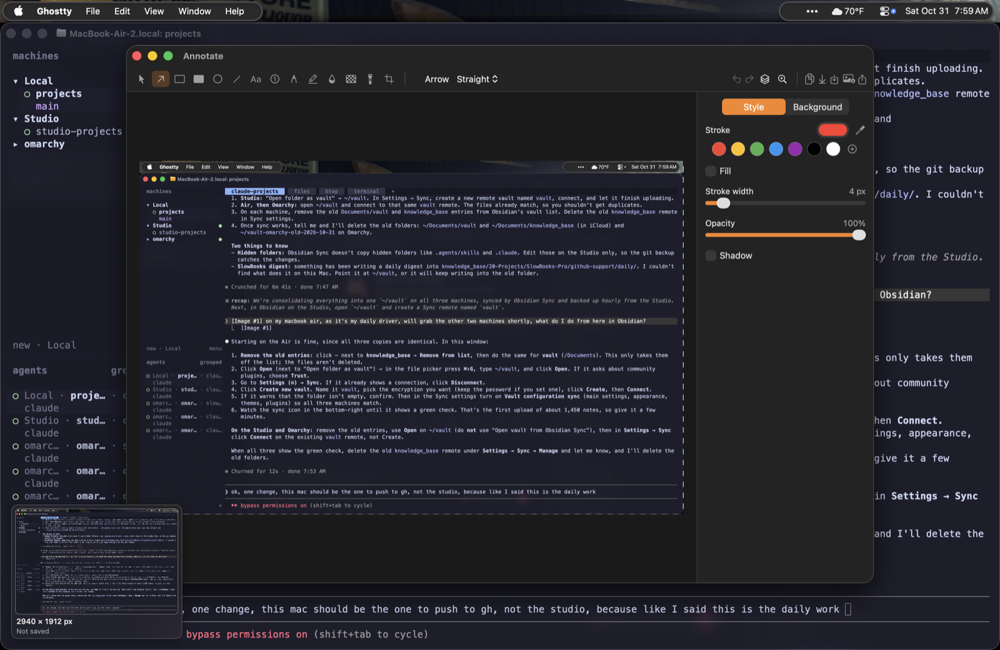
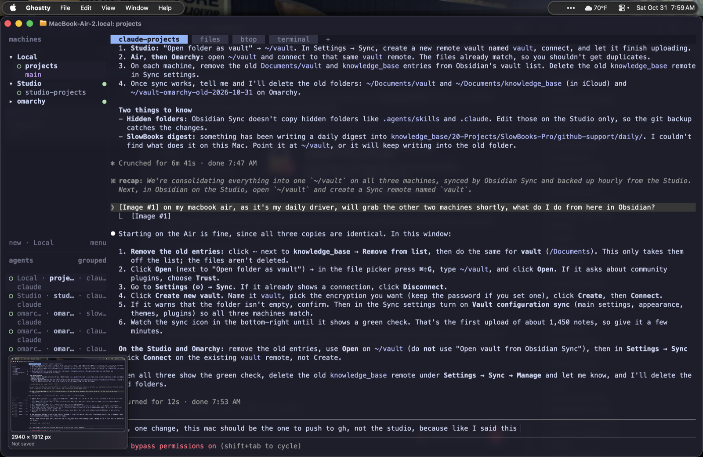

# ScreenCap

An open-source screenshot app for macOS. It lives in the menu bar: capture an area, a
window, the full screen, or a scrolling page from a global shortcut, then copy, save,
annotate, pin, or pull the text out of it. No accounts, no cloud, no telemetry. MIT.

Requires macOS 14 Sonoma or newer.





## Features

**Capture**
- Area, window, fullscreen, previous area, self-timer (3/5/10 s), and all-in-one (draw a
  rectangle, then pick the mode from a small toolbar).
- Frozen screen while you select, with crosshair and magnifier (pixel grid, coordinates,
  size, hex color). Type an exact size or lock an aspect ratio.
- Window capture with or without shadow, even when other windows overlap. Space toggles
  area/window.
- Scrolling capture: scroll yourself or let the app do it, get one stitched image with
  fixed headers and footers kept once.
- Capture text: OCR straight to the clipboard; also reads QR codes and barcodes.
- Hide desktop icons while capturing.

**After capture**
- A thumbnail in a screen corner with copy, save, annotate, pin, OCR, reveal, and delete.
  Drag it into any app, swipe it away, or let it close itself. Captures stack.
- Each shortcut can have its own after-capture action: overlay, copy, save, annotate, pin.

**Annotate**
- Arrows (4 styles), rectangles, ellipses, lines, text (7 styles), numbered counters,
  smoothed pencil, a highlighter that snaps to text lines, spotlight.
- Secure blur and randomized pixelate (the defaults) scramble the pixels so OCR can't read the
  text back. Smooth blur is cosmetic only: don't use it on secrets.
- Crop with aspect ratios, rotate, flip, resize, screen color picker with a saved palette,
  drop in another image.
- Background tool: padding, corner radius, shadow, bundled or custom backgrounds, Auto
  Balance, presets.
- Every object stays editable. Export PNG, JPEG, HEIC, TIFF, or PDF, or save a
  `.screencap` project to reopen later. Share sheet. Blur and pixelate are flattened into a
  saved project, so the original pixels never leave your Mac in the file.

**Also**
- Pin any capture as a floating, always-on-top image; lock it so clicks pass through.
- History of the last 30 days, searchable by the text in each capture.
- `screencap://` URL scheme for scripts, Raycast, Alfred, and Shortcuts.
- Settings for save folder, filename template, format, Retina scale, overlay position,
  launch at login, and more.

## Install

**Download.** Get `ScreenCap-<version>.dmg` from
[Releases](https://github.com/ContractorKeith/screen-cap/releases), open it, and drag
ScreenCap to Applications.

**First launch.** Builds are ad-hoc signed and not notarized yet, so macOS blocks the first open:

- **macOS 15 and later:** open ScreenCap once and click **Done** on the "Not Opened" dialog.
  Then go to **System Settings → Privacy & Security**, scroll to "ScreenCap was blocked…",
  click **Open Anyway**, authenticate, and open ScreenCap again. Or, in Terminal:
  `xattr -d com.apple.quarantine /Applications/ScreenCap.app`
- **macOS 14:** right-click ScreenCap.app → **Open** → **Open**.

After that it opens normally. Each new version you download needs this once more.

**Homebrew** (after the first tagged release; the cask isn't published yet).

```bash
brew tap ContractorKeith/tap
brew install --cask screen-cap
```

The cask will live in [ContractorKeith/homebrew-tap](https://github.com/ContractorKeith/homebrew-tap);
the source copy is [Casks/screen-cap.rb](Casks/screen-cap.rb). Homebrew quarantines the app
too, so the first-launch steps above apply.

Updates: **Check for Updates…** in the menu. Until signed update feeds are set up it opens
the Releases page.

## First run

1. The welcome window asks for **Screen Recording** permission, with **Later** and
   **Open System Settings** buttons. Click **Open System Settings**, then turn ScreenCap on in
   Privacy & Security → Screen & System Audio Recording. macOS may ask you to quit and reopen it.
2. Once permission is on, the same window shows the main shortcuts and a **Take Your First
   Screenshot** button. Tick "Don't show again" to skip it next time; **Welcome…** in the menu
   brings it back.

**After an update.** Until builds are Developer ID signed, macOS may treat a new version as a new
app: the old ScreenCap toggle stays on but no longer applies, and the welcome window says
"ScreenCap was updated". Run `tccutil reset ScreenCapture com.contractorkeith.screencap` in
Terminal (the window has a **Copy Command** button), then click **Open System Settings** and turn
ScreenCap on again. Selecting the old entry and clicking **–** works too.

**Accessibility** is requested only the first time you use auto-scroll in scrolling capture,
because scrolling for you means posting scroll events. Nothing else is requested.

## Default shortcuts

All use ⌃⇧ so they never clash with macOS's ⇧⌘3/4/5. Change them in Settings → Shortcuts.

| Action | Shortcut |
|---|---|
| Capture Area | ⌃⇧4 |
| Capture Window | ⌃⇧W |
| Capture Fullscreen | ⌃⇧3 |
| Capture Previous Area | ⌃⇧R |
| Self-Timer | ⌃⇧T |
| All-In-One | ⌃⇧5 |
| Scrolling Capture | ⌃⇧S |
| Capture Text | ⌃⇧O |
| Open History | ⌃⇧H |
| Hide/Show Overlays | ⌃⇧X |
| Focus Quick Access | ⌃⇧Q |

**Keyboard.** In a focused Quick Access panel: ⌘C copy, ⌘S save, ⌘E or Return annotate, ⌘P pin,
⌘T copy text, ⌘R show in Finder, ⌫ delete (asks first if the capture was never saved), ⌘⌫ delete
without asking, Esc close, Tab or the arrows for the next panel.
In History: arrows move (⇧ extends the selection), Return opens in the editor, Space previews,
⌘C copies, ⌘A selects all, ⌫ deletes.

## Automation

```bash
open "screencap://capture-area?action=copy"
```

Every command and parameter is in [docs/url-scheme.md](docs/url-scheme.md).

## Build from source

SwiftPM only; Command Line Tools are enough, no Xcode needed.

```bash
git clone https://github.com/ContractorKeith/screen-cap.git
cd screen-cap
make build      # debug build
make test       # Swift Testing suite (adds the right paths on a CLT-only Mac)
make run        # release build into build/ScreenCap.app, ad-hoc signed, then launch
make dmg        # dist/ScreenCap-<version>.dmg
make lint       # swiftlint --strict
```

Builds are ad-hoc signed with a fixed identifier and designated requirement, so a rebuild can
keep its Screen Recording grant. If macOS asks again anyway, reset it as in "After an update" above.
If Xcode is installed but its license isn't accepted, run
`export DEVELOPER_DIR=/Library/Developer/CommandLineTools` first.

Xcode users can `xcodegen generate && open ScreenCap.xcodeproj`; that path is secondary.
Architecture, plan, and feature matrix: [docs/PLAN.md](docs/PLAN.md). Releases:
[CHANGELOG.md](CHANGELOG.md).

## File format

`.screencap` projects are a folder package with `document.json` plus PNG layers, so every
annotation stays editable. Spec: [docs/file-format.md](docs/file-format.md).

## Scope

Screenshots, editing, and saving. Screen recording is a later phase. Hosted cloud
sharing, accounts, and teams are not planned.

## Contributing

Open an issue before anything larger than a bug fix. Logic goes in ScreenCapKit where it
can be tested headless; keep the app target thin. `make test` and `make lint` must pass.

## License

MIT. See [LICENSE](LICENSE).

ScreenCap is an independent project and is not affiliated with CleanShot. It uses
its own name, icon, interface, backgrounds, and file format.
